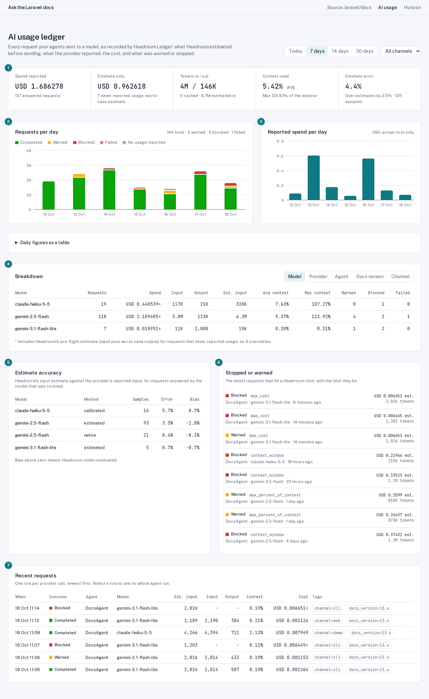

# Livewire dashboard example

A complete AI usage dashboard built only on Headroom Ledger's public query API: one Livewire component, one view, one badge component and a stylesheet. It is an example to copy and change, not part of the package (it is left out of the Composer archive).

It was built and tested in a copy of [laravel-docs-rag-playground](https://github.com/phoenix1331/laravel-docs-rag-playground), a Laravel 13 app that answers questions about the Laravel docs, with both packages installed from Packagist and its docs agent guarded by `EnsureHeadroom`.

<picture>
  <source media="(prefers-color-scheme: dark)" srcset="../../docs/ledger-dashboard-dark.png">
  
</picture>

The numbered panels are listed in [Where each panel comes from](#where-each-panel-comes-from).

## Requirements

| | |
|---|---|
| Headroom Ledger | installed, migrated and recording ([README](../../README.md#install)) |
| Livewire | 3 or 4 |
| Tailwind CSS | v4 (the view uses utility classes; the stylesheet adds the rest) |
| A layout | `resources/views/layouts/app.blade.php` with a `$slot`, or change `#[Layout]` |

## Install

1. Copy the files into your app, keeping their paths:

   | File | Role |
   |---|---|
   | `app/Livewire/LedgerDashboard.php` | Filters, every query, and the shaping of results for the view |
   | `app/Ledger/LedgerFormat.php` | Money, token, percentage and agent formatting |
   | `resources/views/livewire/ledger-dashboard.blade.php` | The page |
   | `resources/views/components/ledger-outcome.blade.php` | Outcome badge (colour always beside its label) |
   | `resources/css/ledger-dashboard.css` | Chart, table and tile styles plus colour roles, light and dark |

2. Import the stylesheet after Tailwind in `resources/css/app.css`:

   ```css
   @import 'tailwindcss';
   @import './ledger-dashboard.css';
   ```

3. Add a route, behind whatever authorisation suits your app:

   ```php
   // Livewire 4
   Route::livewire('/ledger', \App\Livewire\LedgerDashboard::class)->middleware('can:viewAiUsage');

   // Livewire 3
   Route::get('/ledger', \App\Livewire\LedgerDashboard::class)->middleware('can:viewAiUsage');
   ```

4. Set `FILTER_TAG` in the component to an allowlisted tag (for example `tenant_id`), and add `tag:<key>` entries to `GROUPINGS` for any tag you want to group by. The filter menu lists the values recorded in the last 30 days.

No data yet? Seed some with the factory the package ships:

```php
use Phoenix1331\AiHeadroomLedger\Database\Factories\LedgerEntryFactory;

LedgerEntryFactory::new()->count(200)->withTags(['channel' => 'web'])->create();
```

## Where each panel comes from

| Panel | Query API |
|---|---|
| Filters (top right) | `Ledger::query()->lastDays($days)->forTag(FILTER_TAG, $value)` |
| 1 Headline tiles | `spend()` (reported and estimate-only kept apart), `tokens()`, `context()`, `accuracy()->overall()` |
| 2, 3 Requests and spend per day | `byDay()->context()`, `byDay()->tokens()`, `byDay()->spend()`; every day of the range is returned, empty days included |
| 4 Breakdown | `byModel()`, `byProvider()`, `byAgent()` or `byTag($key)`, then `spend()`, `tokens()`, `context()` |
| 5 Estimate accuracy | `accuracy()`, per model and count method |
| 6 Stopped or warned | `blocked()->entries(8)` |
| 7 Recent requests | `entries(25)` |
| Agent run panel (select a row in 7) | `Ledger::run($invocationId)` |

Every result is a readonly value object (`SpendSummary`, `TokenTotals`, `ContextUsage`, `Breakdown`, `LedgerEntry`...), so the same calls work behind Blade, Inertia or a JSON API. Aggregates read daily rollups for closed days and raw entries for today, so the page stays fast as the ledger grows.

## Design notes

- **Spend never mixes the two kinds.** Reported cost and estimate-only cost are separate tiles, and any total that includes an estimate is starred. Headroom estimates the worst case (input plus maximum output), so estimates overstate.
- **Charts plot one currency** (Headroom's configured currency); tables list each currency separately, because the ledger never converts.
- **Outcome colours are status colours**, always paired with a label; the estimate breakdown uses a fixed colour per section, so a colour always means the same section.
- **Every chart has a table view** (the "Daily figures as a table" panel), and columns are focusable with a tooltip on hover or focus.

[Filament Headroom](https://github.com/phoenix1331/filament-headroom) will package a dashboard like this for Filament panels. This example is for apps that want their own.
